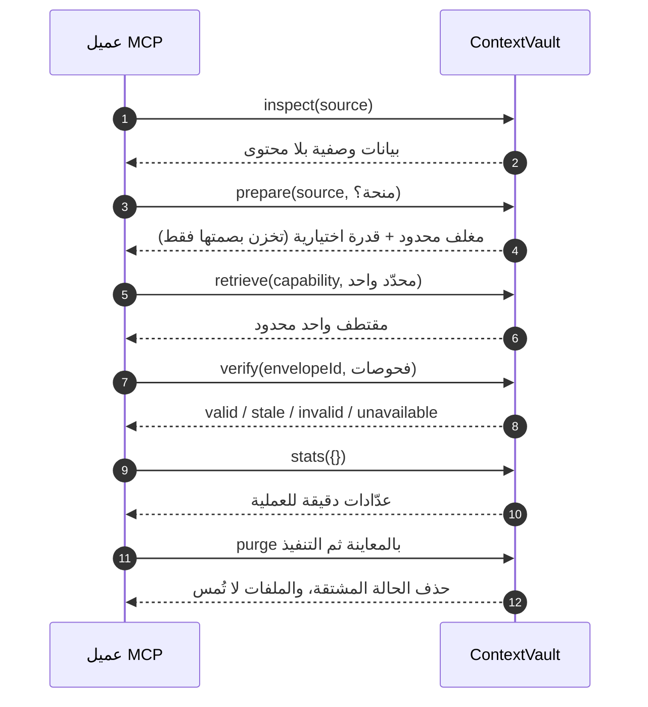
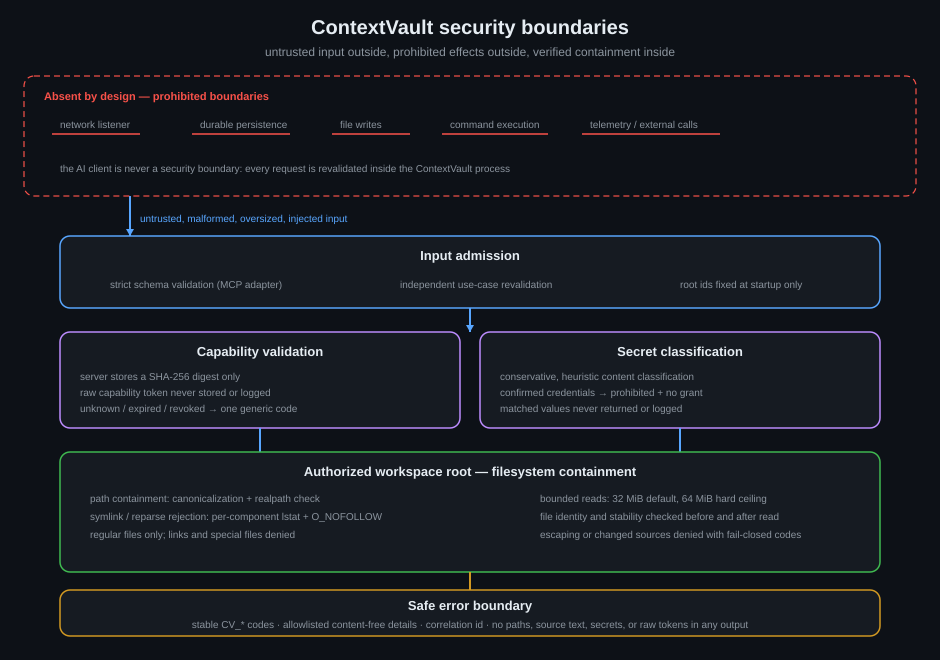

<div dir="rtl">

<p align="center">
  
</p>

<h1 align="center">ContextVault</h1>

<p align="center">
  <strong>خادم MCP محلي يمنح عملاء الذكاء الاصطناعي وصولًا متحكمًا به إلى ملفات المصادر المصرّح بها، مع حفظ الأدلة.</strong>
</p>

<p align="center">
  <a href="README.md">بوابة اللغة</a> · <a href="README.en.md">English</a> · <a href="docs/GETTING_STARTED.ar.md">التثبيت والاستخدام</a> · <a href="SECURITY.md">الأمان</a> · <a href="LICENSE">Apache-2.0</a>
</p>

---

## ما هو ContextVault

خادم MCP محلي لمن يريد أن يعمل عميل الذكاء الاصطناعي مع ملفات حقيقية على
القرص دون أن يسلّمه مفاتيح كل شيء. يستطيع العميل أن يفحص البيانات الوصفية
الخالية من المحتوى لملفٍ ما، وأن يجهّز مغلفًا بنيويًا محدودًا، وأن يسحب
مقتطفًا دقيقًا فقط عبر رمز قدرة، ثم يتحقق من أن أدلته المجهزة ما زالت تطابق
الملف، ويقرأ عدّادات دقيقة، ويمسح كل الحالة المشتقة عند الانتهاء.

المشكلة التي يعالجها مألوفة: عملاء الذكاء الاصطناعي الذين يعملون على مصادر
محلية كبيرة يحتاجون أدلة دقيقة — أي ملف، وأي بايتات، وأي بصمة — دون بلع صامت
لملفات كاملة أو أسرار أو مسارات غير مصرح بها. يجيب ContextVault على أسئلة
«ما هذا المصدر؟ وهل من الآمن الإحالة إليه؟ وما الذي قرأته بالضبط؟» عبر
معرّفات معتمة وبصمات SHA-256 ومخرجات محدودة وتحقق قابل للفحص الآلي.

المنفَّذ فعليًا اليوم:

- ست أدوات MCP صارمة تُخدم عبر `stdio` المحلي فقط، كعملية ابنة لمضيف MCP
  لديك.
- تصريح بجذور مساحة العمل عند بدء العملية صراحة؛ وعدم تصريح أي جذر وضع
  صحيح يمنع كل قراءة.
- بيانات وصفية خالية من المحتوى (inspect)، وأغلفت بنيوية محدودة (prepare)،
  ومقتطفات دقيقة مشروطة برمز قدرة (retrieve)، ونتائج سلامة حتمية (verify)،
  وعدّادات دقيقة (stats)، وحذف على خطوتين للحالة المشتقة (purge).
- الحالة المشتقة في ذاكرة خاصة بالعملية فقط، مع TTL وسقوف صارمة. تُمسح
  الذاكرة عند خروج العملية.
- كل فشل يتحول إلى مغلف `CV_*` مستقر وخالٍ من المحتوى ومعه معرّف ارتباط.

ما لا يفعله: لا مستمع شبكي، لا تتبعًا عن بُعد، لا واجهات خارجية، لا قاعدة
بيانات، لا استمرارية خارج ذاكرة العملية، لا كتابة ملفات، لا تنفيذ أوامر،
لا تسجيل جذور أثناء التشغيل.

## المعمارية

<p align="center">
  
</p>

الاعتمادات تتجه إلى الداخل: محولات MCP تستدعي حالات الاستخدام، وحالات
الاستخدام تفرض سياسات النطاق، ومحولات البنية التحتية تنفّذ المنافذ المعرّفة
في التطبيق. والنطاق لا يعتمد على شيء.يفحص
`scripts/check-architecture.mjs` هذه الحدود آليًا.

## الأدوات الست

| الأداة                  | الوظيفة                                                                                                                                                            | تكشف المحتوى؟        |
| ----------------------- | ------------------------------------------------------------------------------------------------------------------------------------------------------------------ | -------------------- |
| `contextvault_inspect`  | بيانات وصفية خالية من المحتوى لملف مصرّح واحد: `sourceId` و`sourceDigest` و`mediaType` و`bytes` و`sensitivity` و`secretRisk` و`supportedSelectors` و`inspectedAt`. | لا                   |
| `contextvault_prepare`  | مغلف بنيوي محدود: وصف المقاطع، ووصف عقد JSON، والإسقاطات، وبصمة بنيوية، وTTL، وكتلة قدرة `retrieval` اختيارية.                                                     | لا                   |
| `contextvault_retrieve` | مقتطف دقيق محدود لمصدر مجهّز. يتطلب رمز `capability` ومحدّدًا واحدًا بالضبط (`chunk` أو `json_node` أو `line_range`).                                              | نعم، في حدود المقتطف |
| `contextvault_verify`   | فحوصات سلامة حتمية (`source_freshness` و`chunk_integrity` و`provenance_consistency`) بنتائج `valid` / `stale` / `invalid` / `unavailable`.                         | لا                   |
| `contextvault_stats`    | عدّادات دقيقة خاصة بالعملية. إدخال فارغ صارم.                                                                                                                      | لا                   |
| `contextvault_purge`    | حذف على خطوتين للحالة المشتقة في الذاكرة: `preview` يعيد `purgeIntentId` ثم `execute` يحذف. الملفات لا تُمس.                                                       | لا                   |

## التوصيل ودورة الطلب

<p align="center">
  
</p>

كل أداة نقطة استدعاء MCP مستقلة. التسلسل التالي مسار موصى به للعميل وليس
سلسلة داخلية؛ لا شيء يعمل بين الاستدعاءات، وكل استدعاء يُعاد التحقق منه من
الصفر.



نسخة متحركة من تدفق الطلب مع مسار الفشل المغلق في
[docs/assets/contextvault-runtime-flow.gif](docs/assets/contextvault-runtime-flow.gif)
(البديل الثابت:
[docs/assets/contextvault-runtime-flow-static.svg](docs/assets/contextvault-runtime-flow-static.svg)).

## نموذج الأمان

<p align="center">
  
</p>

- **محلي فقط.** MCP فوق `stdio` كعملية ابنة يطلقها العميل. لا منافذ، لا
  شبكة، لا تتبع، لا نداءات خارجية.
- **تصريح صريح.** تُعرَّف الجذور عند البدء بصيغة
  `--workspace-root=<root-id>=<absolute-path>`؛ وكل طلب يعيد التحقق من
  معرّف الجذر والمسار النسبي استقلالًا عن مخطط النقل.
- **احتواء.** توحيد مسارات، ورفض `lstat` لكل مكوّن من الروابط والملفات
  الخاصة، واحتواء `realpath`، وقراءات محدودة بفحوص هوية وثبات قبل القراءة
  وبعدها.
- **تصنيف متحفظ.** بنى بيانات الاعتماد المؤكدة ترفع `sensitivity` إلى
  `prohibited` و`secretRisk` إلى `confirmed`؛ والقيم المطابقة لا تُعاد ولا
  تُسجَّل، ولا تُمنح أي صلاحية استرجاع.
- **انضباط رموز القدرة.** يخزن الخادم بصمة SHA-256 لكل رمز استرجاع فقط؛
  وكل إخفاقات القدرة تتشارك رمزًا عامًا واحدًا.
- **حدود على كل شيء.** قراءة المصدر 32MiB افتراضيًا ولا تتجاوز سقفًا صارمًا
  64MiB؛ المقتطفات حتى 1MiB؛ المغلفات النشطة 64؛ الحالة المشتقة 4MiB
  إجمالًا؛ البيانات الوصفية المتسلسلة 256KiB؛ صلاحية المغلف 60–7200 ثانية
  (الافتراضي 1800)؛ التجهيزات المتوازية عمليتان والسقف 4 مع مهلة 30 ثانية؛
  فحوص التحقق 16 لكل استدعاء؛ نوايا المحو المعلقة 16.
- **أخطاء آمنة.** رموز `CV_*` مستقرة، وتفاصيل `safeDetails` من قائمة سماح
  فقط، ومعرّف ارتباط في كل استجابة، و`isError: true` عند الإخفاق.

عميل الذكاء الاصطناعي ليس حدَّ أمان أبدًا. كل طلب يُعاد التحقق منه وإعادة
تصريحه داخل عملية ContextVault نفسها.

## حدود الموارد

هذه القيم من التنفيذ نفسه لا من التسويق:

| المورد                            | الحد الحالي                     |
| --------------------------------- | ------------------------------- |
| قراءة المصدر                      | 32MiB افتراضيًا؛ سقف صارم 64MiB |
| ناتج الاسترجاع                    | 1MiB كحد أقصى                   |
| المغلفات النشطة                   | 64                              |
| الحالة المشتقة في الذاكرة         | 4MiB إجمالًا                    |
| البيانات الوصفية المتسلسلة للمغلف | 256KiB                          |
| صلاحية المغلف                     | 60–7200 ثانية؛ الافتراضي 1800   |
| التجهيزات المتوازية               | عمليتان افتراضيًا؛ السقف 4      |
| مهلة التحضير والاسترجاع           | 30 ثانية لكل عملية              |
| مقاطع المغلف                      | 1024 مقطعًا × 4096 بايت         |
| فحوص التحقق                       | 16 لكل استدعاء                  |
| نوايا المحو المعلقة               | 16                              |

## التثبيت والتشغيل

لا توجد حزمة npm منشورة؛ التثبيت من نسخة مصدرية فقط. الدليل الكامل —
المتطلبات والتثبيت والبناء وتهيئة العميل ودورة الاستخدام الآمنة والأخطاء
الشائعة والإيقاف — في
[docs/GETTING_STARTED.ar.md](docs/GETTING_STARTED.ar.md).

الخلاصة:

```bash
corepack enable
corepack prepare pnpm@11.19.0 --activate
pnpm install --frozen-lockfile
pnpm run build
node dist/main.js --workspace-root=demo=C:/Projects/ExampleWorkspace
```

تهيئة عميلة محايدة لمضيف MCP:

```json
{
  "mcpServers": {
    "contextvault": {
      "command": "node",
      "args": [
        "C:/Projects/ContextVault/dist/main.js",
        "--workspace-root=project=C:/Projects/ExampleWorkspace"
      ]
    }
  }
}
```

مسارات JSON على ويندوز: استخدم الخطوط الأمامية (`C:/…`) أو الخطوط الخلفية
المضاعفة (`C:\\…`). تفاصيل الاتصال وجداول الأخطاء:
[docs/INTEGRATION.md](docs/INTEGRATION.md).

دورة الاستخدام الآمنة في سطر لكل خطوة:

1. **Inspect** للمصدر ← بيانات وصفية بلا محتوى.
2. **Prepare** بمنحة ضيقة ← `envelopeId` مع قدرة اختيارية.
3. **Retrieve** عند الحاجة الصريحة فقط ← مقتطف واحد محدود ببصمته.
4. **Verify** قبل الاقتباس ← نتائج سلامة لكل فحص.
5. **Stats** بـ`{}` ← عدّادات دقيقة.
6. **Purge** على خطوتين ← تُمسح الحالة المشتقة ولا تُمس الملفات.

مثال رفض:

```json
{
  "schemaVersion": "1.0",
  "ok": false,
  "error": {
    "code": "CV_AUTHORIZATION_DENIED",
    "message": "The requested source is not authorized.",
    "correlationId": "cv_corr_xxxxxxxxxxxxxxxx",
    "retryable": false
  }
}
```

## الحدود

- التصنيف وكشف نوع الوسائط تقديري ومتحفظ؛ والإيجابيات والسلبيات الكاذبة
  ممكنة أمام مدخلات عدائية.
- سلوك توحيد المسارات وطي حالة الأحرف يُختبر بصورة حتمية لكل من دلالتي
  مسارات ويندوز و POSIX على أي مضيف، وبضد نظام ملفات المضيف الحقيقي في
  جناح التكامل.
- التحقق يثبت الاتساق الداخلي للحالة المجهزة، لا الأصالة الخارجية ولا صدق
  أي عبارة.
- عدّادات Stats دفتر تشغيلي داخل العملية، وليست دليل تدقيق.
- Purge يمسح ذاكرة العملية فقط؛ ولا يجوز المبالغة بضماناته.
- لا مقاييس أداء ولا حمل Fuzzing موسع مقدَّم.

## حالة التحقق

مقاسة على هذا الخط الأساسي (2026-10-02)، ويندوز 11، وNode 24.14.1،
وpnpm 11.19.0:

- جناح الاختبارات الكامل: 49 ملفًا و1168 اختبارًا كلها ناجحة؛ والتغطية 100%
  للأسطر والتعابير والدوال و99.89% للفروع، بالعتبات المهيأة (90/95/95/95)
  مفروضة وغير مخفَّضة.
- سير CI في المستودع (المهمة `Verify`: تنسيق وفحص ساكن وأنواع وحدود
  معمارية ومخططات وأسرار وبناء واختبارات بتغطية) يعمل على GitHub Actions
  ويمكن مراجعة أحدث تشغيل لفرع `main` في
  [صفحة Actions](https://github.com/D0shi-Eng/Context_Vault/actions).
- اختبار طفرات مستهدف سابق على كود سلطة الوصول إلى الملفات بنتيجة 99.40%، ووحدة
  القارئ نفسها 100%.
- تدقيق الاعتماديات: 0 ثغرات معروفة أبلغ عنها `pnpm audit` وقت التنفيذ.
  مسح الأسرار: لا بصمات عالية الثقة.
- بناء نظيف، وتجربة تغليف جافة، وجلسة stdio حية ضد مخرجات البناء الطازجة.

هذا المستودع يضم نسخة تطويرية، والتثبيت من المصدر فقط:
لا توجد حزمة npm منشورة، ولا خدمة مستضافة، ولا إصدار رسمي معتمد على
GitHub. ويبقى وصف «معاينة تطويرية» هو الوصف الصادق للنضج: لا ادعاء هنا
بالجاهزية الإنتاجية ولا بتدقيق أمني مستقل ولا بالملاءمة لأي نظام التزام
بعينه.

## المهارة

المهارة في [skills/contextvault/SKILL.md](skills/contextvault/SKILL.md)
(وأمثلتها في
[skills/contextvault/references/examples.md](skills/contextvault/references/examples.md))
تُرشد الوكيل للعمل عبر inspect ← prepare ← retrieve ← verify ← stats ←
purge، مع الاسترجاع عند الحاجة الصريحة فقط، وإعادة التحقق بعد القراءة،
والمحو في نهاية المهمة. انسخ مجلد `skills/contextvault/` إلى مجلد مهارات
عميلك؛ ويبقى تنفيذ الأدوات داخل خادم MCP.

## الإبلاغ الأمني والمساهمة

راجع [SECURITY.md](SECURITY.md). لا تفتح Issues عامة للاشتباه بثغرات.
ولوضع المساهمة الحالي راجع [CONTRIBUTING.md](CONTRIBUTING.md).

## الترخيص

مرخّص بموجب [Apache License 2.0](LICENSE). الإسناد: [NOTICE](NOTICE).

</div>
