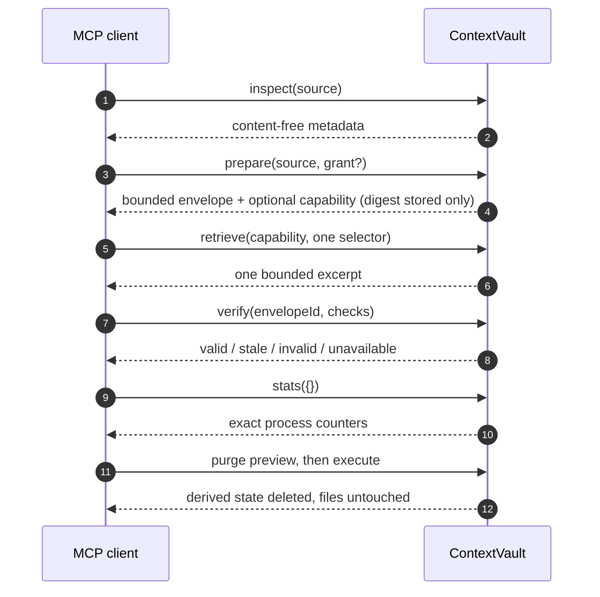

<p align="center">
  
</p>

<h1 align="center">ContextVault</h1>

<p align="center">
  <strong>A local-first MCP server that gives AI clients controlled, evidence-preserving access to explicitly authorized source files.</strong>
</p>

<p align="center">
  <a href="README.md">Language gate</a> · <a href="README.ar.md">العربية</a> · <a href="docs/GETTING_STARTED.en.md">Installation &amp; usage</a> · <a href="SECURITY.md">Security</a> · <a href="LICENSE">Apache-2.0</a>
</p>

---

## What ContextVault is

ContextVault is a local MCP server for people who want an AI client to work
with real files on disk without handing the client the keys to everything.
The client can inspect a file's content-free metadata, prepare a bounded
structural envelope, pull an exact excerpt only through a capability token,
verify that its prepared evidence still matches the file, read exact
counters, and purge all derived state when done.

The problem it addresses is familiar: AI clients working with large local
sources need exact evidence — which file, which bytes, which digest — without
silently ingesting whole files, secrets, or unapproved paths. ContextVault
answers "what is this source, is it safe to reference, and what exactly did I
read?" with opaque identifiers, SHA-256 digests, bounded outputs, and
machine-checkable verification.

What is implemented today:

- Six strict MCP tools served over local `stdio` only, as a child process of
  your MCP host.
- Explicit workspace-root authorization at process startup; zero roots is
  valid and denies every read.
- Content-free metadata (inspect), bounded structural envelopes (prepare),
  capability-gated exact excerpts (retrieve), deterministic integrity
  results (verify), exact counters (stats), and two-step derived-state
  deletion (purge).
- Derived state kept in process-scoped memory only, with TTL and hard
  ceilings. Memory clears on process exit.
- Every failure mapped to a stable, content-free `CV_*` error envelope with
  a correlation identifier.

What it does not do: no network listener, no telemetry, no external APIs,
no database, no persistence beyond process memory, no file writing, no
command execution, no runtime root registration.

## Architecture

<p align="center">
  
</p>

Dependencies point inward: MCP adapters call application use cases, use
cases enforce domain policies, and infrastructure adapters implement
application ports. The domain depends on nothing.
`scripts/check-architecture.mjs` enforces these boundaries automatically.

## The six tools

| Tool                    | Function                                                                                                                                                           | Reveals content         |
| ----------------------- | ------------------------------------------------------------------------------------------------------------------------------------------------------------------ | ----------------------- |
| `contextvault_inspect`  | Content-free metadata for one authorized file: `sourceId`, `sourceDigest`, `mediaType`, `bytes`, `sensitivity`, `secretRisk`, `supportedSelectors`, `inspectedAt`. | No                      |
| `contextvault_prepare`  | Bounded structural envelope: chunk descriptors, JSON node descriptors, omissions, structural fingerprint, TTL, and an optional `retrieval` capability block.       | No                      |
| `contextvault_retrieve` | Exact bounded excerpt for a prepared source. Requires the capability token plus exactly one selector (`chunk`, `json_node`, `line_range`).                         | Yes, within the excerpt |
| `contextvault_verify`   | Deterministic integrity checks (`source_freshness`, `chunk_integrity`, `provenance_consistency`) with `valid` / `stale` / `invalid` / `unavailable` results.       | No                      |
| `contextvault_stats`    | Exact process-scoped counters. Strict empty input.                                                                                                                 | No                      |
| `contextvault_purge`    | Two-step deletion of in-memory derived state: `preview` returns a `purgeIntentId`, `execute` deletes. Files untouched.                                             | No                      |

## Runtime wiring and request lifecycle

<p align="center">
  
</p>

Each tool is an independently callable MCP endpoint. The sequence below is a
recommended client workflow, not internal chaining; nothing runs between
calls, and every call is revalidated from scratch.



An animated version of the request flow, with the fail-closed path, is in
[docs/assets/contextvault-runtime-flow.gif](docs/assets/contextvault-runtime-flow.gif)
(static fallback:
[docs/assets/contextvault-runtime-flow-static.svg](docs/assets/contextvault-runtime-flow-static.svg)).

## Security model

<p align="center">
  
</p>

- **Local only.** MCP over `stdio` as a client-spawned child process. No
  ports, no network, no telemetry, no external calls.
- **Explicit authorization.** Roots are declared at startup as
  `--workspace-root=<root-id>=<absolute-path>`; every request revalidates
  the root id and the relative path independently of the transport schema.
- **Containment.** Canonicalization, per-component `lstat` denial of links
  and special files, `realpath` containment, bounded reads with pre/post
  identity and stability checks.
- **Conservative classification.** Confirmed credential structures force
  `sensitivity: prohibited` and `secretRisk: confirmed`; matched values are
  never returned or logged, and no retrieval grant is issued.
- **Capability discipline.** The server stores only a SHA-256 digest of each
  retrieval token; all capability failures share one generic code.
- **Bounded everything.** Source reads default to 32 MiB and cannot exceed a
  64 MiB hard ceiling; excerpts are capped at 1 MiB; active envelopes at 64;
  total derived state at 4 MiB; serialized envelope metadata at 256 KiB;
  TTL at 60–7200 s (default 1800 s); concurrent preparations at 2 (hard cap 4) with a 30 s prepare/retrieve deadline; verification at 16 checks per
  call; pending purge intents at 16.
- **Safe errors.** Stable `CV_*` codes, allowlisted `safeDetails` only,
  correlation id on every response, `isError: true` on failures.

The AI client is never a security boundary. Every request is revalidated
and reauthorized inside the ContextVault process.

## Resource limits

These values come from the implementation, not marketing:

| Resource                     | Current limit                       |
| ---------------------------- | ----------------------------------- |
| Source read                  | 32 MiB default; 64 MiB hard ceiling |
| Retrieve output              | 1 MiB maximum                       |
| Active envelopes             | 64                                  |
| Derived state in memory      | 4 MiB total                         |
| Serialized envelope metadata | 256 KiB                             |
| Envelope TTL                 | 60–7200 s; default 1800 s           |
| Concurrent preparations      | 2 default; hard cap 4               |
| Prepare/retrieve deadline    | 30 s per operation                  |
| Envelope chunks              | 1024 chunks × 4096 bytes each       |
| Verification checks          | 16 per call                         |
| Pending purge intents        | 16                                  |

## Installation and operation

There is no published npm package; install from a source checkout only.
The full guide — requirements, install, build, host configuration, one safe
usage cycle, common errors, and shutdown — lives in
[docs/GETTING_STARTED.en.md](docs/GETTING_STARTED.en.md).

Short version:

```bash
corepack enable
corepack prepare pnpm@11.19.0 --activate
pnpm install --frozen-lockfile
pnpm run build
node dist/main.js --workspace-root=demo=C:/Projects/ExampleWorkspace
```

Client-neutral MCP host configuration:

```json
{
  "mcpServers": {
    "contextvault": {
      "command": "node",
      "args": [
        "C:/Projects/ContextVault/dist/main.js",
        "--workspace-root=project=C:/Projects/ExampleWorkspace"
      ]
    }
  }
}
```

Windows JSON paths: use forward slashes (`C:/…`) or doubled backslashes
(`C:\\…`). Connection details and error tables:
[docs/INTEGRATION.md](docs/INTEGRATION.md).

A safe usage cycle in one line each:

1. **Inspect** the source → content-free metadata.
2. **Prepare** with a narrow grant → `envelopeId` + optional capability.
3. **Retrieve** only on explicit need → one bounded excerpt with digest.
4. **Verify** before quoting → per-check integrity results.
5. **Stats** with `{}` → exact counters.
6. **Purge** in two steps → derived state deleted, files untouched.

Example denial:

```json
{
  "schemaVersion": "1.0",
  "ok": false,
  "error": {
    "code": "CV_AUTHORIZATION_DENIED",
    "message": "The requested source is not authorized.",
    "correlationId": "cv_corr_xxxxxxxxxxxxxxxx",
    "retryable": false
  }
}
```

## Limitations

- Classification and media-type detection are heuristic and conservative;
  false positives and negatives are possible on adversarial input.
- Path canonicalization and case-folding behavior is exercised
  deterministically for both the Windows and POSIX path dialects on any
  host, and against the real host filesystem in the integration suite.
- Verification proves internal consistency of prepared state, not external
  authenticity or the truth of any statement.
- Stats counters are operational bookkeeping, not audit evidence.
- Purge deletes process memory; its guarantees must not be overstated.
- No benchmarks or extended fuzzing campaign are provided.

## Verification status

Measured on this baseline (2026-10-02), Windows 11, Node 24.14.1,
pnpm 11.19.0:

- Full test suite: 49 files, 1168 tests, all passing; coverage 100% lines /
  statements / functions and 99.89% branches, with the configured
  thresholds (90/95/95/95) enforced and not lowered.
- The repository CI workflow (job `Verify`: formatting, lint, types,
  architecture, schemas, secrets, build, tests with coverage) runs on
  GitHub Actions. Check the latest `main` run in this repository's
  [Actions tab](https://github.com/D0shi-Eng/Context_Vault/actions).
- Previous targeted mutation testing on the workspace file-authority code scored
  99.40%, with the reader module itself at 100%.
- Dependency audit: 0 known vulnerabilities reported by `pnpm audit` at
  execution time. Secret scan: no high-confidence signatures.
- Clean build, package dry-run, and a live stdio end-to-end session against
  the freshly built output.

This source repository contains a development preview. Install
from source only: there is no published npm package, no formal GitHub
Release, and no hosted service. "Development preview" remains the honest
description of maturity: nothing here claims production readiness, a
security audit, or fitness for any specific compliance regime.

## Skill

The Skill at [skills/contextvault/SKILL.md](skills/contextvault/SKILL.md)
(with examples in
[skills/contextvault/references/examples.md](skills/contextvault/references/examples.md))
teaches an agent to work through inspect → prepare → retrieve → verify →
stats → purge with retrieve only on explicit need, re-verification after
reading, and purge at task end. Copy the `skills/contextvault/` directory
into your client's skills directory; tool execution stays inside the MCP
server.

## Security reporting and contributing

See [SECURITY.md](SECURITY.md). Do not open public issues for suspected
vulnerabilities. See [CONTRIBUTING.md](CONTRIBUTING.md) for the current
contribution posture.

## License

Licensed under the [Apache License, Version 2.0](LICENSE). Attribution:
[NOTICE](NOTICE).
