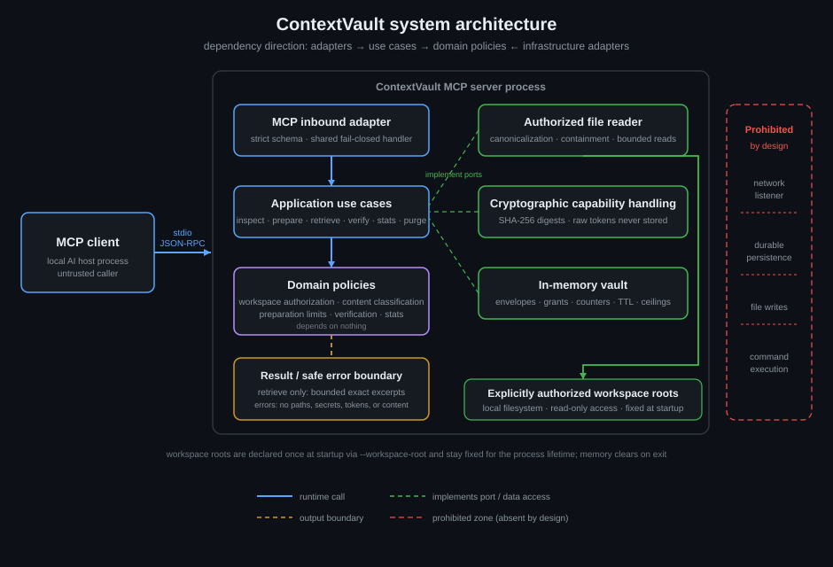
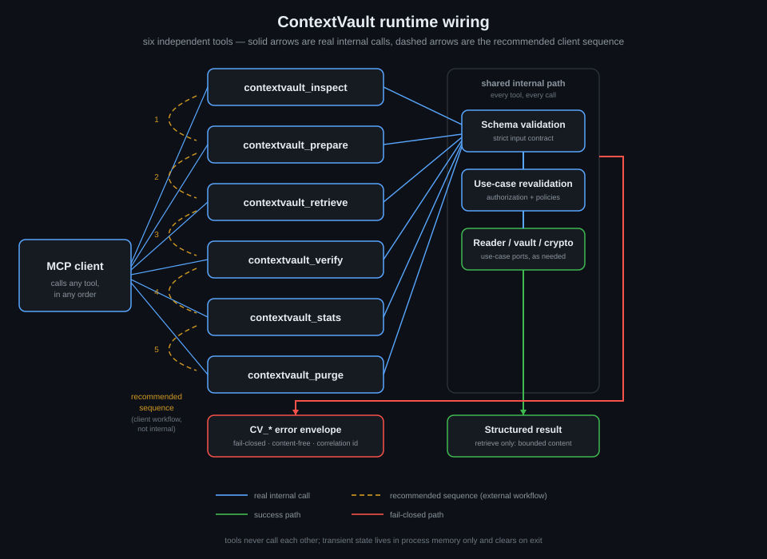
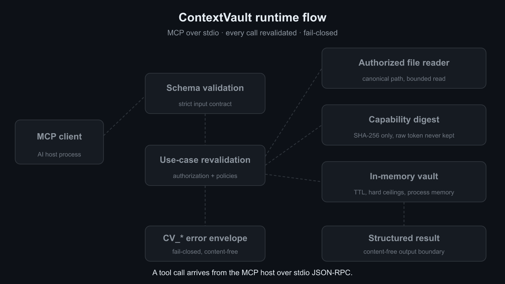

<p align="center">
  
</p>

<h1 align="center">ContextVault</h1>

<p align="center">
  <strong>A local-first MCP server that gives AI clients controlled, evidence-preserving access to explicitly authorized source files: content-free inspection, capability-gated exact retrieval, and deterministic integrity verification.</strong>
</p>

<p align="center" dir="rtl">
  <strong>خادم MCP محلي يمنح عملاء الذكاء الاصطناعي وصولًا متحكمًا به إلى ملفات المصادر المصرّح بها مع حفظ الأدلة: فحص خالٍ من المحتوى، واسترجاع دقيق مشروط برموز قدرة، وتحقق حتمي من السلامة.</strong>
</p>

<p align="center">
  <a href="README.en.md"></a>
  <a href="README.ar.md"></a>
  <a href="docs/GETTING_STARTED.en.md"></a>
  <a href="docs/GETTING_STARTED.ar.md"></a>
  <a href="SECURITY.md"></a>
  <a href="LICENSE"></a>
</p>

<p align="center">
  Development preview. Install from source only. No published npm package, hosted service, or formal release. Local operation over stdio only: no network listener, no persistence beyond process memory.
</p>

---

## System architecture

<p align="center">
  
</p>

## Runtime wiring

<p align="center">
  
</p>

## Runtime flow

<p align="center">
  <a href="docs/assets/contextvault-runtime-flow.gif"></a>
</p>

<p align="center">
  Static fallback: <a href="docs/assets/contextvault-runtime-flow-static.svg">contextvault-runtime-flow-static.svg</a>
</p>

## The six tools

| Tool                    | Function                                                                                                          |
| ----------------------- | ----------------------------------------------------------------------------------------------------------------- |
| `contextvault_inspect`  | Content-free metadata for one authorized file: ids, digest, media type, size, sensitivity. Never returns content. |
| `contextvault_prepare`  | Bounded structural envelope with optional retrieval grant. Raw-content-free.                                      |
| `contextvault_retrieve` | One bounded excerpt, only with a capability token and exactly one selector. The only content-revealing tool.      |
| `contextvault_verify`   | Deterministic integrity checks: `valid` / `stale` / `invalid` / `unavailable`.                                    |
| `contextvault_stats`    | Exact process-scoped counters. Strict empty input.                                                                |
| `contextvault_purge`    | Two-step deletion of ContextVault-owned in-memory derived state. Files untouched.                                 |

Each tool is an independent MCP call. The inspect → prepare → retrieve → verify →
stats → purge order is a recommended client workflow, not internal chaining.

## Quick start

Prerequisites: **Node.js 24+** and **pnpm 11.19.0**.

```bash
pnpm install --frozen-lockfile
pnpm run build
node dist/main.js --workspace-root=demo=C:/Projects/ExampleWorkspace
```

Full guides: **English** [docs/GETTING_STARTED.en.md](docs/GETTING_STARTED.en.md) ·
**العربية** [docs/GETTING_STARTED.ar.md](docs/GETTING_STARTED.ar.md)

Deeper wiring: [docs/architecture/RUNTIME_WIRING.md](docs/architecture/RUNTIME_WIRING.md) ·
Skill: [skills/contextvault/SKILL.md](skills/contextvault/SKILL.md) ·
Security policy: [SECURITY.md](SECURITY.md) · License: [Apache-2.0](LICENSE) ·
Attribution: [NOTICE](NOTICE)
