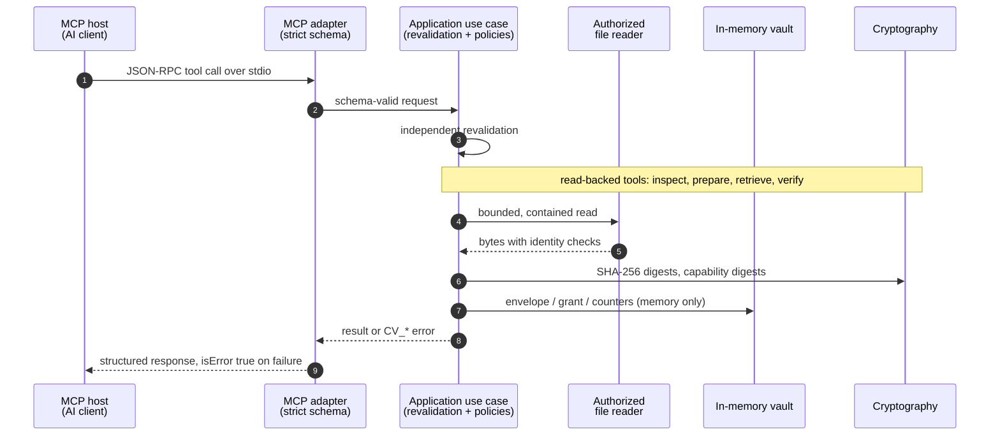
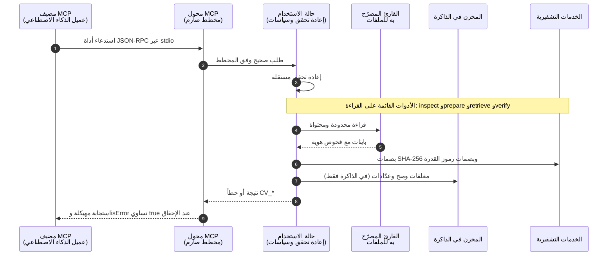

# ContextVault runtime wiring | توصيلات تشغيل ContextVault

[English](#english) · [العربية](#العربية)

---

## English

This document describes the implemented runtime path. It intentionally excludes
planning notes, historical reports, and unimplemented components.

### Transport and admission

1. A local MCP host starts `dist/main.js` as a child process.
2. JSON-RPC travels through standard input and standard output only.
3. The MCP adapter applies a strict zod schema and rejects unknown fields.
4. The application use case independently validates the request again.
5. The shared handler records the outcome and converts every failure into a
   stable, content-safe `CV_*` envelope with a correlation identifier.

### Independent tool wiring

The six tools are independently callable. The common inspect → prepare →
retrieve → verify → stats → purge sequence is a recommended client workflow,
not an internal chain of tool calls.

| Tool                    | Primary application path                                                                      | Primary dependencies                                    | Disclosure                     |
| ----------------------- | --------------------------------------------------------------------------------------------- | ------------------------------------------------------- | ------------------------------ |
| `contextvault_inspect`  | authorize → bounded read → digest → classify                                                  | authorized reader, cryptography, clock                  | Content-free metadata          |
| `contextvault_prepare`  | authorize → read → classify → structural scan → envelope → optional grant                     | reader, vault, identifiers, cryptography, token service | Content-free structure         |
| `contextvault_retrieve` | validate capability → load state → re-read → verify digest → re-bind state → select → excerpt | reader, vault, token digester/comparator, cryptography  | One bounded excerpt            |
| `contextvault_verify`   | load envelope → re-read → deterministic checks                                                | reader, vault, provenance, cryptography                 | Content-free integrity results |
| `contextvault_stats`    | sweep expiry → snapshot counters                                                              | vault, request counters, clock                          | Content-free counters          |
| `contextvault_purge`    | preview target → bind intent to snapshot → execute removal                                    | vault, identifiers, clock, cryptography                 | Content-free removal summary   |

### File authority

Workspace roots are fixed at startup. For every read, the authorized reader
normalizes the relative path, rejects linked or special components with
per-component `lstat`, checks canonical containment with `realpath`, opens the
target read-only with `O_NOFOLLOW`, enforces the byte limit, and compares file
identity and stability before and after reading.

### Derived state

Prepared envelopes, capability digests, retrieval provenance, counters, and
purge intents exist only in process memory. TTL sweeps, resource ceilings,
revocation, and two-step purge constrain that state. Process exit clears it.

### Output boundary

- Inspect, prepare, verify, stats, and purge return content-free structured data.
- Retrieve is the only content-revealing tool and returns one authorized,
  selector-bound, byte-bounded excerpt.
- Any tool may return a fail-closed `CV_*` error. Stack traces, absolute paths,
  raw source content, secrets, and raw capability tokens are never serialized.

---

## العربية

يصف هذا القسم مسار التشغيل المنفّذ فقط، ولا يتضمن خططًا مستقبلية أو تقارير
تاريخية أو مكونات غير مبنية.

### النقل وقبول الطلب

1. يشغّل مضيف MCP المحلي الملف `dist/main.js` كعملية ابنة.
2. تنتقل رسائل JSON-RPC عبر الإدخال القياسي والإخراج القياسي فقط.
3. يطبق محول MCP مخطط zod صارمًا ويرفض الحقول المجهولة.
4. تعيد حالة الاستخدام التحقق من الطلب بصورة مستقلة.
5. يسجل المعالج المشترك نتيجة الطلب، ويحوّل كل فشل إلى غلاف `CV_*` ثابت
   وآمن للمحتوى ويحمل معرّف ارتباط.

### توصيل الأدوات المستقلة

كل أداة من الأدوات الست قابلة للاستدعاء مباشرة. أما التسلسل فحص ← تحضير ←
استرجاع ← تحقق ← إحصاءات ← محو الحالة فهو مسار استخدام موصى به للعميل، وليس
سلسلة استدعاءات داخلية بين الأدوات.

| الأداة                  | المسار التطبيقي الأساسي                                                                           | الاعتمادات الأساسية                             | الإفصاح                |
| ----------------------- | ------------------------------------------------------------------------------------------------- | ----------------------------------------------- | ---------------------- |
| `contextvault_inspect`  | تفويض → قراءة محدودة → بصمة → تصنيف                                                               | القارئ المصرّح، التشفير، الساعة                 | بيانات وصفية بلا محتوى |
| `contextvault_prepare`  | تفويض → قراءة → تصنيف → مسح بنيوي → مغلف → منحة اختيارية                                          | القارئ، المخزن، المعرّفات، التشفير، خدمة الرموز | بنية بلا محتوى خام     |
| `contextvault_retrieve` | تحقق من القدرة → تحميل الحالة → إعادة القراءة → تحقق من البصمة → إعادة ربط الحالة → تحديد → مقتطف | القارئ، المخزن، بصمة الرمز ومقارنتها، التشفير   | مقتطف واحد محدود       |
| `contextvault_verify`   | تحميل المغلف → إعادة القراءة → فحوص حتمية                                                         | القارئ، المخزن، سجل المنشأ، التشفير             | نتائج سلامة بلا محتوى  |
| `contextvault_stats`    | تنظيف المنتهي → لقطة للعدادات                                                                     | المخزن، عدادات الطلبات، الساعة                  | عدادات بلا محتوى       |
| `contextvault_purge`    | معاينة الهدف → ربط النية بلقطة الحالة → تنفيذ المحو                                               | المخزن، المعرّفات، الساعة، التشفير              | ملخص محو بلا محتوى     |

### سلطة الوصول إلى الملفات

تُثبَّت جذور مساحة العمل عند تشغيل العملية. وفي كل قراءة، يطبّع القارئ المسار
النسبي، ويرفض الروابط والملفات الخاصة بواسطة `lstat` لكل مكوّن، ويتحقق من
الاحتواء الفعلي بواسطة `realpath`، ويفتح الملف للقراءة فقط مع `O_NOFOLLOW`،
ويفرض حد البايتات، ثم يقارن هوية الملف وثباته قبل القراءة وبعدها.

### الحالة المشتقة

توجد المغلفات المحضّرة وبصمات رموز القدرة وسجلات منشأ الاسترجاع والعدادات
ونوايا محو الحالة داخل ذاكرة العملية فقط. وتقيّدها مدد الصلاحية وحدود الموارد
والإبطال والمحو ذي الخطوتين. تزول هذه الحالة بخروج العملية.

### حدود المخرجات

- تعيد أدوات الفحص والتحضير والتحقق والإحصاءات ومحو الحالة بيانات منظمة بلا
  محتوى خام.
- الاسترجاع هو الأداة الوحيدة الكاشفة للمحتوى، ويعيد مقتطفًا واحدًا مفوضًا
  ومقيّدًا بالمحدد وسقف البايتات.
- قد تعيد أي أداة خطأ `CV_*` بفشل مغلق. ولا تُسلسل مكدسات الاستثناء أو المسارات
  المطلقة أو محتوى المصدر الخام أو الأسرار أو رموز القدرة الخام.
