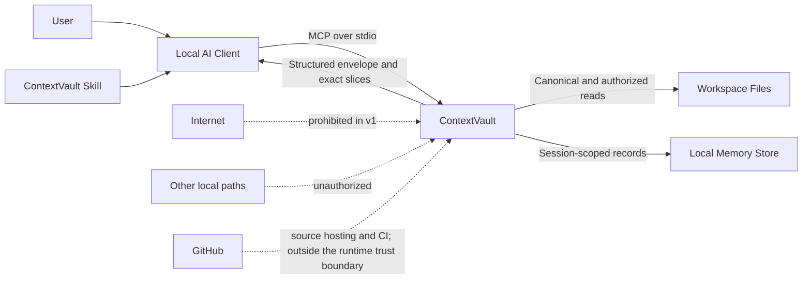

# System Context

## Actors and systems

| Actor or system          | Trust level                                   | Responsibility                                                                             |
| ------------------------ | --------------------------------------------- | ------------------------------------------------------------------------------------------ |
| User                     | Trusted for intent, not for input safety      | Selects workspaces, tasks, and release decisions.                                          |
| AI client                | Authenticated local peer, untrusted arguments | Invokes MCP tools and consumes structured results.                                         |
| ContextVault Skill       | Instruction layer                             | Guides safe tool selection and evidence verification.                                      |
| ContextVault MCP process | Trusted computing base                        | Enforces schemas, authorization, extraction, retrieval, and audit policy.                  |
| Workspace filesystem     | Mixed trust                                   | Contains authorized files and potentially malicious content.                               |
| Local operating system   | Environmental trust                           | Provides process, path, permission, clock, and storage primitives.                         |
| Package registry         | Untrusted supply-chain source                 | Distributes dependencies and release packages.                                             |
| Source host              | External development system                   | Hosts the source repository and runs its CI; it is not part of the runtime trust boundary. |

## Context diagram

## Primary data flows

1. The user authorizes workspace roots when starting ContextVault.
2. The AI client sends a schema-valid tool request over `stdio`.
3. ContextVault validates the request independently of Skill instructions.
4. The filesystem adapter canonicalizes the requested relative path and re-checks root containment.
5. The inspection or preparation use case reads bounded content.
6. Deterministic extractors produce exact anchors and omission records.
7. The application stores the exact source in session memory when retrieval is required.
8. The capability service returns a scoped, opaque retrieval capability.
9. The AI client may request a bounded exact slice.
10. The verifier maps candidate claims to exact evidence.

## Security invariant

Neither the AI client nor the Skill is a security boundary. Every request is revalidated and reauthorized inside the ContextVault process.
