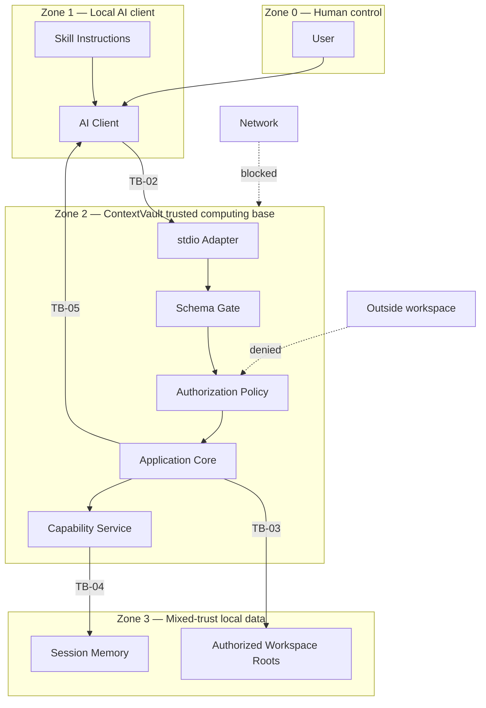

# Trust Boundaries

## TB-01 — User to AI client

User intent enters an AI system that may misunderstand, omit, or transform instructions. ContextVault cannot assume that a tool request accurately represents the user's intent solely because it came from the AI client.

**Control:** Restrict tools to read-only behavior except explicit purge, require declared roots at startup, and expose destructive semantics clearly.

## TB-02 — AI client to MCP process

Tool arguments are untrusted even on `stdio`. They may be malformed, oversized, injected, replayed, or generated from malicious source content.

**Control:** Strict schemas, authorization, hard limits, deadlines, cancellation, safe errors, and per-session state.

## TB-03 — MCP process to workspace filesystem

An authorized workspace may contain symlinks, junctions, special files, malicious filenames, rapidly changing paths, oversized content, and secret material.

**Control:** Canonicalization, final-path containment, reparse-point policy, bounded reads, file-identity checks, type detection, and secret-risk denial.

## TB-04 — Application core to session store

Stored sources and capabilities are sensitive. A global key or unscoped lookup could leak content between sessions or workspaces.

**Control:** Session and workspace namespace, source digest binding, authenticated capabilities, expiry, revocation, and no content logging.

## TB-05 — Extracted content to AI client

Source data may contain prompt injection that attempts to override the Skill or cause unsafe tool calls.

**Control:** Mark all source-derived text as untrusted data, preserve provenance, separate instructions from content, and never convert embedded text into executable policy.

## TB-06 — Development environment to dependencies

Package installation and lifecycle scripts can execute third-party code.

**Control:** Dependency minimization, locked versions, provenance review, install-script review, SBOM, vulnerability scanning, and reproducible CI.

## TB-07 — Source repository to release artifacts

Build workflows, credentials, tags, generated packages, or registry publication may be tampered with.

**Control:** Least-privilege workflows, protected branches and tags, signed revisions, provenance, checksums, SBOM matching, and maintainer-approved release.

## Boundary diagram

